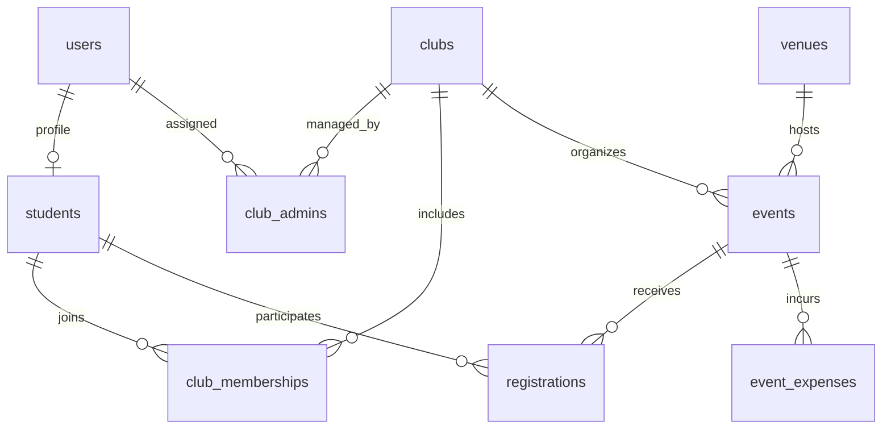

# University Event and Club Management - Raw SQL Edition

An independent university DBMS lab application using Flask, psycopg 3 and handwritten
PostgreSQL SQL. Students explore clubs/events and track participation; club admins
manage assigned clubs/events/attendance/expenses; system admins manage clubs,
venues and assignments.

**Stage 5 complete: 228 passed, 0 failed, 0 skipped.** Nine base tables and all
original constraints are preserved. Three normal reporting views and 32 fictional
demo records were deployed only after explicit approval. The original project and
database are untouched. No commit, push or hosting deployment was performed.
Submission target: 16 November 2026 (Asia/Dhaka).

[Viva guide](docs/DBMS_VIVA_GUIDE.md) |
[SQL demo order](sql/demo/README.md) | [Demo guide](docs/DEMO_DATA_GUIDE.md) |
[Submission checklist](docs/SUBMISSION_CHECKLIST.md)

## HOW TO LAUNCH THE WEBSITE

This machine already has the configured NEW database, virtual environment, approved
views and fictional demo data. Direct Python commands need no virtual-environment
activation or PowerShell execution-policy change.

```powershell
Set-Location 'D:\dbms_project_raw_sql'
.\.venv\Scripts\python.exe -m flask --app run:app db-check
.\.venv\Scripts\python.exe run.py
```

Open **http://127.0.0.1:5000/**. Stop with Ctrl+C. The server is localhost-only and
debug is off. Styling is served locally and needs no classroom internet.

Demo identifiers: `labdemo.club@example.invalid` and
`labdemo.student1@example.invalid` through `labdemo.student3@example.invalid`.
Use the private demo passphrase configured locally; it is not printed here or
included in the ZIP. No public default password exists.

Create your own INITIAL system administrator using hidden prompts:

```powershell
.\.venv\Scripts\python.exe -m flask --app run:app create-admin
```

This refuses an existing system admin; it never overwrites/resets one. The seeded
manager is a club admin. Extra club-admin accounts use `create-club-admin`, then
a system admin assigns them through a club detail page.

## Objectives and technology

Demonstrate normalized relational design, parameterized raw SQL, constraints,
indexes/views, ACID transactions, race-safe registration, scoped authorization,
exact aggregates and safe exports. No SQLAlchemy, Flask-SQLAlchemy, Alembic,
Flask-Migrate or other ORM is used or required.

Tested: Python 3.12.9, PostgreSQL 18.6, Flask 3.1.3, Flask-Login 0.6.3,
psycopg/psycopg-binary 3.3.9, Werkzeug scrypt, python-dotenv, pytest and Bootstrap
5.3.3. requirements-lock.txt records tested runtime/test versions. Playwright is
optional QA tooling, not a website launch requirement.

## Architecture and project structure

```text
dbms_project_raw_sql/
  app/
    __init__.py, config.py, db.py, sql.py
    auth.py, security.py, validation.py, management.py
    events.py, event_services.py, event_validation.py
    reports.py, report_queries.py, report_validation.py, csv_export.py
    demo_seed.py
    templates/{auth,management,events,reports,errors}/
    static/{css/style.css,vendor/bootstrap.min.css,favicon.svg}
  sql/
    schema/{01_create_tables.sql,02_constraints_indexes.sql}
    queries/01_basic_selects.sql ... 13_demo_seed.sql
    reports/{01_create_reporting_views.sql,02_pgadmin_examples.sql}
    demo/01_schema_constraints_indexes.sql ... 05_live_catalog_read_only.sql
    demonstrations/01_registration_locks.sql
  scripts/    # private secret initialization, HTTP/browser/SQL QA, ZIP packager
  tests/      # all original regressions plus stage-specific tests
  docs/       # viva, approval/demo plans, screenshots and checklist
  .env.example, .gitignore, requirements*.txt, pytest.ini, run.py
  STAGE*_TEST_RESULTS.xml  # retained test results
  .env        # PRIVATE; excluded from version control/submission
  .demo/      # PRIVATE ownership manifest; excluded
  .venv/, .cache/, submission/  # local tools/output; not source
```

Request flow: browser -> Flask blueprint -> validation and role/scope checks ->
trusted named SQL -> psycopg transaction/cursor -> PostgreSQL -> escaped Jinja or
safe CSV. There is no ORM model/session layer. Startup never creates schema/views
or seeds records.

| Major source | Responsibility |
| --- | --- |
| app/__init__.py | Factory, blueprints, exact DB-name guard, safe client/server errors |
| app/config.py | Loads only the NEW .env, environment overrides and no secret defaults |
| app/db.py | Lazy dict_row connections, isolation, commit/rollback/cleanup and safe errors |
| app/sql.py | Trusted cached named SQL loader, parameter binding and cursor handling |
| app/auth.py | Plain UserMixin, SQL user loader, scrypt, sessions, roles/scope, admin CLI |
| app/security.py | Expiring CSRF, secure cookies, local stylesheet CSP and no-store headers |
| app/management.py | Own profiles, clubs/assignments/memberships, venue/capacity management |
| app/event_services.py | Lock-ordered scheduling, seat allocation, cancellation and attendance |
| app/events.py | Event forms/filters/details, registrations, participants and availability |
| app/report_queries.py | Scoped parameter construction and exact aggregate report APIs |
| app/reports.py | Expense CRUD/confirmation, report filters/pages and CSV exports |
| app/csv_export.py | UTF-8/CRLF quoting, exact Decimal text and formula-prefix protection |
| app/*validation.py | Whitelisted identity, text, password, time, date, money and capacity rules |
| app/demo_seed.py | Preview/check/apply, collision refusal, private ownership and no-op repeats |
| templates/static | Responsive offline Bootstrap UI, accessible validation and recovery actions |
| scripts/init_secret.py | Privately initializes a random local secret, preserving existing values |
| scripts/verify_stage5_http.py | Complete rollback-only actual HTTP workflows |
| scripts/verify_stage5_browser.py | Real desktop/mobile browser QA and safe screenshots |
| scripts/verify_sql_demos.py | Runs only reviewed TEMP/read-only educational SQL |
| scripts/package_submission.py | Positive-list, secret-checked ZIP and SHA-256 file manifest |

## Database design and all nine tables

| Table | Actual attributes and purpose |
| --- | --- |
| users | user_id PK; full_name, unique normalized email, password_hash, role |
| students | student_id PK; unique user_id FK, unique student_number, department, batch |
| clubs | club_id PK; unique club_name, description, is_active, created_at |
| club_memberships | membership_id PK; club_id/student_id FKs, joined_at, status |
| club_admins | club_admin_id PK; club_id/user_id FKs and unique assignment pair |
| venues | venue_id PK; unique venue_name, location, capacity |
| events | event_id PK; club_id/venue_id FKs, title, description, start_time, end_time, capacity, status |
| registrations | registration_id PK; event_id/student_id FKs, registered_at, status |
| event_expenses | expense_id PK; event_id FK, description, amount, expense_date |



All 46 columns are NOT NULL. There are 9 sequence-backed integer PKs, 10 ON DELETE
RESTRICT FKs, 19 CHECKs, 7 UNIQUE constraints plus a unique email index, and 31 total
indexes. FK lookups have leading index coverage. CHECKs enforce statuses/roles,
positive capacities, valid times, nonnegative money, normalized email and selected
nonblank text. Lifetime uniqueness covers membership, admin assignment and event
registration pairs. Deactivation/cancellation preserves relationships.

Timestamps use TIMESTAMP WITH TIME ZONE and display in Asia/Dhaka. Money is
NUMERIC(12,2)/Decimal, assumed BDT. PostgreSQL 18 records 46 NOT NULL constraints
separately; these are not extra CHECK expressions. Exact DDL is in sql/schema.

## Handwritten SQL used by the site

| sql/queries file | Executed behavior |
| --- | --- |
| 01_basic_selects.sql | Standalone teaching SELECTs only, not Flask runtime |
| 02_authentication.sql | User lookup, account insert and advisory bootstrap lock |
| 03_students.sql | Joined profiles/directory and ownership-derived updates |
| 04_clubs.sql | Directory/filter/locks/create/edit/status and admin scope |
| 05_memberships.sql | Joined histories/member lists and lifetime transitions |
| 06_venues.sql | Venue reads/create/edit/lock and existing-event capacity guard |
| 07_events.sql | Event JOIN/filter/detail/create/edit/status and scheduling locks |
| 08_registrations_attendance.sql | Row locks/create/update, histories and participant JOINs |
| 09_expenses.sql | Scoped INSERT/SELECT/UPDATE/DELETE, search and totals |
| 10_financial_reports.sql | Grouped event/club/month totals and missing/positive spending |
| 11_participation_reports.sql | Grouped status/occupancy/attendance/month/club metrics |
| 12_reporting_choices.sql | Scoped choices and student's own participation summary |
| 13_demo_seed.sql | Operator-only approved seed INSERTs, never automatic startup |

Fixed query names and source files are trusted. Values use separate `%s` tuples,
for example `sql.read('auth.by_email', (normalized_email,), one=True)`. Request
values never become SQL filenames, query text or identifiers. Seeder identifiers
come only from a fixed whitelist. SQL-looking input remains data.

## Connections, authentication and permission matrix

Connections open lazily only to university_events_raw. dict_row returns named
columns. Cursors close, transactions commit or roll back, and connections always
close. Related mutations share one transaction. Reads use read-only REPEATABLE
READ for stable multi-query report snapshots; writes explicitly use READ COMMITTED.
Driver/constraint failures roll back before safe HTTP errors.

Registration atomically creates users+students with fixed role=student. Scrypt
hashes are salted; plaintext passwords, hashes and permission lists never go into
browser sessions. The signed session stores the user ID/session metadata; SQL
reloads the role each request. Sessions rotate on login/logout, expire after eight
hours, disable remember-me and use HttpOnly/SameSite cookies. Unsafe methods need
an expiring CSRF token. Jinja escapes HTML; safe-next validation blocks redirects
to external sites. APP_ENV=production enables Secure cookies/HSTS and needs HTTPS.

| Capability | Student | Club admin | System admin |
| --- | --- | --- | --- |
| Profile | Own name/department/batch edit | None | Student read directory |
| Club creation/status/assignments | None | None | All |
| Club details/members/events/attendance | None | Assigned clubs only | All |
| Club join/leave and event participation | Own only | None | None |
| Venue create/edit | None | None | All |
| Expenses/reports/aggregate CSV | None | Assigned clubs only | All |

Anonymous visitors may browse clubs/events/venues/availability. Protected routes
redirect to login; wrong roles/scopes get 403. Submitted owner IDs cannot redirect
operations. Scope is rechecked inside write transactions. Email/student number
remain fixed in the UI. Arbitrary role changes and account/profile deletion are
not offered. Admin provisioning is a trusted local operator CLI, not public signup.

## Events, registration, transactions and concurrency

Lock order: Club FOR SHARE -> Venue(s) FOR UPDATE ascending ID -> Event FOR UPDATE
-> Registration/Expense FOR UPDATE. Registration omits Venue locks. Club locks
block deactivation/assignment changes while allowing unrelated events in parallel.
Event ownership cannot change.

Register only for upcoming scheduled events run by an active club; membership is
not required. AFTER acquiring the Event lock, recheck deadline/eligibility and
count occupied seats in the SAME transaction as insert/reactivation. A READ
COMMITTED waiter sees the winner's committed row. Registered and attended occupy
seats; cancelled does not. Duplicate occupied requests are idempotent. Reactivation
updates the lifetime row, preserving its ID and timestamp.

Students cancel before start, or after start if the event is cancelled. Completed/
attended participation cannot be cancelled. Attendance opens at start and can be
corrected registered <-> attended, including after completion. Cancelled records/
events cannot be marked. Cancelled/completed events are final; completion requires
end passed. Only upcoming scheduled events are editable. Capacity cannot exceed
its venue or shrink below occupied seats.

The unchanged btree_gist/GiST exclusion combines equal venue_id and overlapping
`tstzrange(start_time,end_time,'[)')`, excluding cancelled events. Adjacent bookings
are allowed; completed bookings keep their historical interval. Venue locks and
a friendly overlap precheck cooperate with this final database guard. Availability
is advisory and always rechecked at save. Aggregate capacity still requires the
service protocol for every writer, not arbitrary external SQL.

Four actual independent-connection tests observe waiting backend PIDs before
releasing blocker locks: last seat, duplicate request, competing venues and a
direct writer stopped by exclusion. No blind retries risk double-submission.

## Expenses, reporting views, aggregates and CSV

Expense amount range is 0.00..9999999999.99 with at most two decimals; no float
conversion. Negative/scientific/comma/NaN/Infinity/overflow inputs are rejected.
Backdated/future expenses and costs for cancelled/completed events are permitted.
There are no categories, revenue, budget or profit fields. Delete uses a GET
confirmation then CSRF + confirm=delete on POST, removing only that entry.

Finance dates filter expense_date; participation dates filter Dhaka-local event
start days. Children are preaggregated separately before LEFT JOIN: 3 registrations
and 10.10+20.20 expenses still total 30.30. SQL COUNT/SUM/AVG/MIN/MAX, CASE/COALESCE,
CTEs, GROUP BY/HAVING, EXISTS/NOT EXISTS and ORDER BY/LIMIT drive real pages.
Attendance rate applies to completed events and is summed attended/summed occupied,
not an average of event percentages. Undefined rates are N/A.

Three normal views are DEPLOYED after approval: stage4_event_participation_summary,
stage4_event_financial_summary, stage4_club_activity_summary. They contain no
student identities or PUBLIC SELECT grants, store no duplicated data, and do not
replace Flask authorization. Ordinary scoped SELECT reports still work independently.

CSV uses identical scope/filters, all matching events regardless of HTML page,
fixed filenames, UTF-8/CRLF/QUOTE_ALL, exact Decimal text and no-store. Formula
prefixes including whitespace/BOM/full-width variants are neutralized. No student
names/numbers/emails/IDs are exported. Reports use 10-row pages; expense lists use
20-row SQL pages. Large deployments need streaming/database report pagination.

## Fresh Windows installation and PostgreSQL setup

Do NOT recreate the existing configured database on this machine. For an approved
fresh installation, install Python 3.12 and PostgreSQL/client utilities, then:

```powershell
Set-Location 'D:\dbms_project_raw_sql'
python -m venv .venv
.\.venv\Scripts\python.exe -m pip install -r requirements-lock.txt
.\.venv\Scripts\python.exe -m scripts.init_secret
```

init_secret privately initializes .env/SECRET_KEY only when absent, preserving
existing values. Edit the NEW .env locally for PGHOST/PGPORT/PGUSER/PGPASSWORD and
PGDATABASE=university_events_raw. Never copy the original .env or print passwords.
Existing process variables override .env. The blank .env.example is shareable.

Only AFTER explicit fresh-database approval, check absence through postgres.
If it exists, STOP and inspect; never reset/drop it. Match host/port/user to your
new local configuration; -W prompts privately:

```powershell
$env:Path = 'C:\Program Files\PostgreSQL\18\bin;' + $env:Path
psql -X -W -h localhost -p 5432 -U postgres -d postgres -v ON_ERROR_STOP=1 -c "SELECT datname FROM pg_database WHERE datname='university_events_raw';"
# ONLY if absent and approved:
createdb -W -h localhost -p 5432 -U postgres --maintenance-db=postgres --template=template0 university_events_raw
if ($LASTEXITCODE -ne 0) { throw 'Creation failed; stop.' }
psql -X -W -h localhost -p 5432 -U postgres -d university_events_raw -v ON_ERROR_STOP=1 -f sql/schema/01_create_tables.sql
if ($LASTEXITCODE -ne 0) { throw 'Tables failed; stop.' }
psql -X -W -h localhost -p 5432 -U postgres -d university_events_raw -v ON_ERROR_STOP=1 -f sql/schema/02_constraints_indexes.sql
if ($LASTEXITCODE -ne 0) { throw 'Indexes failed; stop.' }
```

Views need separate explicit approval and unused names. The current machine's
views already exist: DO NOT rerun CREATE here. [Deployment plan](docs/VIEW_DEPLOYMENT_PLAN.md)
documents dependencies/collision refusal. Never run original ORM migrations or
connect to university_events.

## Demo data and safe SQL laboratory

The approved labdemo-v1 dataset is installed: 4 users, 3 students, 2 clubs,
3 memberships, 2 admin assignments, 2 venues, 4 events, 7 registrations and
5 expenses = 32 records. Initial expenses total BDT 1205.80; completed attendance
is 2/3 = 66.7%. Identities are fictional, emails use example.invalid.

```powershell
# Offline plan, no DB connection:
.\.venv\Scripts\python.exe -m flask --app run:app seed-demo
# Validates ownership or new inserts then ROLLBACK; no persistent new records:
.\.venv\Scripts\python.exe -m flask --app run:app seed-demo --check
# ONLY after approval on a new installation, with hidden password prompts:
.\.venv\Scripts\python.exe -m flask --app run:app seed-demo --apply
```

Repeat apply verifies .demo/seed-manifest.json and makes no changes. Missing/edited
identities or natural-key collisions refuse rather than overwrite/repair. Dates,
passwords and data are never reset. Existing records must not be deleted. Any future
separately approved cleanup uses exact manifest IDs and FK-safe rollback review,
never prefixes/cascades. Keep the private manifest locally; see the [demo guide](docs/DEMO_DATA_GUIDE.md).

[sql/demo](sql/demo/README.md) files 01-05 cover exact TEMP schema, constraints,
indexes, CRUD, joins/subqueries/aggregates, TEMP views, transactions and locks, then
read-only live catalogs. They are standalone educational scripts, never Flask SQL.
Each file works in psql/pgAdmin on university_events_raw and creates no persistent
objects or live-row mutations.

```powershell
.\.venv\Scripts\python.exe -m scripts.verify_sql_demos
```

[Viva guide](docs/DBMS_VIVA_GUIDE.md): five-minute script and 30 Q&As.
[UI QA](docs/UI_QA.md): real desktop/mobile screenshots.

## Tests and final verification

```powershell
Remove-Item Env:RUN_RAW_SQL_INTEGRATION -ErrorAction SilentlyContinue
.\.venv\Scripts\python.exe -m pytest -q
$env:RUN_RAW_SQL_INTEGRATION = '1'
.\.venv\Scripts\python.exe -m pytest -q --junitxml=STAGE5_TEST_RESULTS.xml
.\.venv\Scripts\python.exe -m scripts.verify_stage5_http
Remove-Item Env:RUN_RAW_SQL_INTEGRATION
.\.venv\Scripts\python.exe -m pip check
.\.venv\Scripts\python.exe -m compileall -q app scripts tests
```

Final full result: **228 passed, 0 failed, 0 skipped in 88.45 seconds**.
Default offline mode also passed: **134 passed, 94 database cases skipped** in 5.51 seconds. All prior
213 cases are preserved; the formerly pending view check now passes. Fifteen new
cases cover offline UI/CLI, seed rollback/idempotence/refusal/password hiding and
all five safe SQL demos. No test was weakened or removed.

Workflow fixtures roll back. Only established race tests temporarily commit then
remove NEW exact-ID fixtures; existing records are never deleted. Fingerprints
prove all 32 approved records unchanged after QA. SERIAL gaps are expected and
never reset. Use no parallel workers/unrelated writers when comparing full-DB
fingerprints. HTTP verifiers also roll back and stop their temporary server.

Optional real browser QA (not a launch requirement):

```powershell
.\.venv\Scripts\python.exe -m pip install -r requirements-dev.txt
$env:PLAYWRIGHT_BROWSERS_PATH='D:\dbms_project_raw_sql\.cache\ms-playwright'
.\.venv\Scripts\python.exe -m playwright install chromium
# Requires privately configured local DEMO_PASSWORD; never print it.
.\.venv\Scripts\python.exe -m scripts.verify_stage5_browser
```

Desktop 1440x1000 and mobile 390x844 checks passed: all assets local, no page errors
or page overflow, real demo logins and accessible invalid-form feedback. Sixteen
screenshots contain no password values. This is headless QA, not exhaustive human
usability/accessibility testing.

## Troubleshooting

| Problem | Action |
| --- | --- |
| Missing Python/dependencies | Use .venv\Scripts\python.exe and requirements-lock.txt |
| SECRET_KEY error | Run scripts.init_secret; never print/commit the key |
| db-check/503 | Check service, NEW .env, role/host/port privately; never reset DB |
| psql missing | Add your installed PostgreSQL bin directory to session PATH |
| Login loop on HTTP | APP_ENV=development locally; production Secure cookies need HTTPS |
| CSRF 400 | Reload; login/logout rotate tokens and forms expire after one hour |
| 403 | Use the correct role and club assignment; do not bypass scope |
| Full/scheduling 409 | Reload, change venue/time or wait for a released seat |
| Unstyled UI | Check /static/vendor/bootstrap.min.css; no CDN needed |
| Port 5000 busy | Stop only your known server or choose another local port |
| Admin bootstrap refusal | Existing admins are deliberately not overwritten |
| Seed/manifest collision | Stop and inspect locally; do not erase/reseed blindly |
| pgAdmin SQL error | ROLLBACK, choose NEW database and run a complete safe demo |
| Browser tooling missing | Install optional dev/browser tools; app launch does not depend on them |

## Submission, security and limitations

```powershell
.\.venv\Scripts\python.exe -m scripts.package_submission
```

submission/ contains a sanitized ZIP and content/hash manifest. Source, blank
example, locked dependencies, tests, SQL, docs/screenshots and evidence are included.
.env, .demo ownership, .git, .venv, browser caches and logs are excluded. The packager
checks configured long secret values before writing. It does not commit, push or
publish. The new directory is not a Git checkout; .gitignore is ready for future
version control and excludes .env/.env.* except the blank example.

Known limits: no password recovery/email verification/arbitrary role editing;
no financial category/revenue/profit fields; local report materialization; external
capacity writers must follow locks. Production needs HTTPS, a production WSGI
server, rate limiting and least-privilege DB credentials. No external CVE or
penetration audit is claimed. Do not publish the development server.

See the [submission checklist](docs/SUBMISSION_CHECKLIST.md) and
[historical notes](docs/IMPLEMENTATION_HISTORY.md). Development-stage reports and
validation JSON outputs were removed; retained test XML and the verification
commands above support reproducible checks. Existing submission archives are
historical snapshots and can be rebuilt with the packaging command. Stop after
Stage 5; further work needs instructions.
